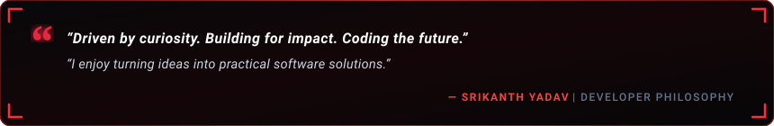

  

  

<!-- SOCIAL MEDIA AND CONTACT BUTTONS -->

  
  &nbsp;
  
  &nbsp;
  
  &nbsp;
  

<!-- PROFILE VISITOR COUNTER -->

  

  

<!-- ======================================================= -->
<!--                   ABOUT ME SECTION                      -->
<!-- ======================================================= -->
<h2 align="center">🔴 About Me</h2>

  

  

  Hello! I'm <b>Srikanth Yadav</b>, a Computer Science and Engineering graduate from India with a strong interest in software development and building practical technology solutions.

  I enjoy developing full-stack applications, working with Python backend systems, integrating databases, exploring cloud deployment and building data-driven applications.

  I have worked on projects involving <b>ESOP management</b>, <b>healthcare applications</b>, <b>employee rewards systems</b>, <b>digital intelligence platforms</b> and <b>data visualisation</b>.

  I continuously explore new technologies and enjoy understanding how software systems work from frontend to backend and deployment.

  
  &nbsp;
  
  &nbsp;
  
  &nbsp;
  

<!-- COMPACT INFORMATION CARDS -->
<table width="100%" border="0" align="center">
<tr>
<td width="50%" align="center" style="padding: 14px;">
  <h4>🎓 Education &amp; Alma Mater</h4>
  
<b>B.Tech in Computer Science &amp; Engineering</b> 
  Class of 2025 &#8226; Malla Reddy Institute of Technology and Science (JNTUH)

</td>
<td width="50%" align="center" style="padding: 14px;">
  <h4>🎯 Primary Focus</h4>
  
<b>Software Development</b> 
  Scalable Web Applications, Robust Backends &amp; System Architecture

</td>
</tr>
<tr>
<td width="50%" align="center" style="padding: 14px;">
  <h4>💡 Professional Interests</h4>
  
<b>Full Stack | Python | Backend | AI | Data Analytics</b> 
  Cloud Deployment, Vector Search &amp; Modern Data Pipelines

</td>
<td width="50%" align="center" style="padding: 14px;">
  <h4>📍 Location &amp; Mobility</h4>
  
<b>Hyderabad, Telangana, India</b> 
  Available for Full-time Software Engineering &amp; Developer Roles

</td>
</tr>
</table>

  

<!-- ======================================================= -->
<!--                 TECHNICAL SKILLS SECTION                -->
<!-- ======================================================= -->
<h2 align="center">🛠️ Technical Skills &amp; Arsenal</h2>

<b>Programming Languages</b>

  

  
  &nbsp;
  
  &nbsp;
  

<b>Frontend Development</b>

  

  
  &nbsp;
  
  &nbsp;
  
  &nbsp;
  
  &nbsp;
  
  &nbsp;
  
  &nbsp;
  

<b>Backend Engineering</b>

  

  
  &nbsp;
  
  &nbsp;
  
  &nbsp;
  
  &nbsp;
  

<b>Databases &amp; Storage</b>

  

  
  &nbsp;
  
  &nbsp;
  

<b>Data Analytics &amp; Artificial Intelligence</b>

  
  &nbsp;
  
  &nbsp;
  
  &nbsp;
  

  
  &nbsp;
  
  &nbsp;
  

<b>Cloud, Containerization &amp; Deployment</b>

  

  
  &nbsp;
  
  &nbsp;
  
  &nbsp;
  

<b>Developer Tools &amp; Environment</b>

  

  
  &nbsp;
  
  &nbsp;
  
  &nbsp;
  

  

<!-- ======================================================= -->
<!--                FEATURED PROJECTS SECTION                -->
<!-- ======================================================= -->
<h2 align="center">🚀 Featured Engineering Projects</h2>

<i>A curated selection of enterprise SaaS platforms, digital intelligence pipelines, full-stack applications, and data analytics systems.</i>

<!-- PROJECT 01: EQUAILY -->
<table width="100%" border="0" align="center">
<tr>
<td style="padding: 18px;">
  

    
    &nbsp;
    
  

  <h3 align="center">💼 EQUAILY – ESOP Management Platform</h3>
  

    <i>EQUAILY is an Employee Stock Option Plan (ESOP) management platform designed to help organisations manage employee stock options, vesting schedules, exercise requests, payment workflows and company-level information.</i>
  

  

    
    
    
    
    
    
    
    
    
    
    
    
    
    
  

  <b>Key Technical Functionalities:</b>
  <ul>
    <li><b>Employee &amp; Company Management:</b> Scalable directory structure handling organizational hierarchy and cap-table data.</li>
    <li><b>ESOP Allocation Management:</b> Granular grant tracking, equity pool reservations, and historical allocation records.</li>
    <li><b>Vesting Schedule Management:</b> Automated calculation engines for graded, cliff, and milestone-based vesting timelines.</li>
    <li><b>Exercise Request Workflows:</b> End-to-end multi-approval lifecycle from exercise submission to approval/rejection.</li>
    <li><b>User Authentication &amp; Sessions:</b> Secure session management with strict role-based access control (RBAC).</li>
    <li><b>Role-Specific Dashboards:</b> Customized interfaces tailored for company executives, HR administrators, and employees.</li>
    <li><b>Payment &amp; Document-Signing Integrations:</b> Integrated financial transactions with Razorpay &amp; Stripe, plus e-signatures via Zoho Sign and scheduled tasks via APScheduler.</li>
  </ul>
  

    
  

</td>
</tr>
</table>

 

<!-- PROJECT 02: DIGITAL INTELLIGENCE PLATFORM -->
<table width="100%" border="0" align="center">
<tr>
<td style="padding: 18px;">
  

    
    &nbsp;
    
  

  <h3 align="center">📊 Digital Intelligence Platform</h3>
  

    <i>A digital intelligence platform designed to analyse website performance, search behaviour, user journeys, conversion funnels and indexing performance by combining Google Analytics 4 (GA4) and Google Search Console (GSC) data.</i>
  

  

    
    
    
    
    
    
    
  

  <b>Key Technical Functionalities:</b>
  <ul>
    <li><b>Search &amp; Exit Journey Analysis:</b> Advanced pathing models tracing organic acquisition through to page abandonment.</li>
    <li><b>Conversion Funnel Analysis:</b> Step-by-step funnel drop-off evaluation identifying checkout and conversion friction points.</li>
    <li><b>Landing Page &amp; Visitor Journey Analysis:</b> Comprehensive performance segmentation based on inbound landing page groups.</li>
    <li><b>Search Query Performance:</b> Correlation of high-intent search queries with on-page dwell time and click-through rates.</li>
    <li><b>Indexing &amp; Crawl Intelligence:</b> Tracking crawler activity, status codes, and indexing coverage across site hierarchies.</li>
    <li><b>Custom Analysis Studio:</b> Ad-hoc analytical querying environment powered by embedded DuckDB and Google BigQuery.</li>
    <li><b>Analytical Visualisation:</b> High-throughput pipeline processing raw telemetry into actionable stakeholder insights.</li>
  </ul>
  

    
  

</td>
</tr>
</table>

 

<!-- PROJECT 03: MEDI CONNECT -->
<table width="100%" border="0" align="center">
<tr>
<td style="padding: 18px;">
  

    
    &nbsp;
    
  

  <h3 align="center">🏥 Medi Connect – Healthcare Platform</h3>
  

    <i>Medi Connect is a healthcare web application designed to make healthcare-related services accessible through a modern, responsive online platform, backed by automated containerization and scalable cloud deployment.</i>
  

  

    
    
    
    
    
    
    
    
    
  

  <b>Key Technical Functionalities:</b>
  <ul>
    <li><b>Responsive Web Application:</b> Modular, accessible interface engineered with Next.js, React, and Tailwind CSS.</li>
    <li><b>User Registration &amp; Authentication:</b> Secure patient and provider onboarding powered by Supabase Auth with session persistence.</li>
    <li><b>Database Operations:</b> Relational data schemas and real-time operational workflows utilizing Supabase PostgreSQL.</li>
    <li><b>Docker Containerisation:</b> Multi-stage Docker builds optimizing production image sizes and operational parity.</li>
    <li><b>Docker Image Management with AWS ECR:</b> Automated container registry tagging, versioning, and security vulnerability scans.</li>
    <li><b>Cloud Deployment via AWS ECS / Fargate:</b> Production serverless container orchestration ensuring automatic scaling and high availability.</li>
  </ul>
  

    
  

</td>
</tr>
</table>

 

<!-- PROJECT 04: PBS - POINTS BASED SYSTEM -->
<table width="100%" border="0" align="center">
<tr>
<td style="padding: 18px;">
  

    
    &nbsp;
    
  

  <h3 align="center">🏆 PBS – Points Based System</h3>
  

    <i>PBS is an employee rewards and recognition management application designed to manage employee recognition requests, approval workflows, points distribution and organisational reporting.</i>
  

  

    
    
    
    
    
    
    
    
    
    
    
  

  <b>Key Technical Functionalities:</b>
  <ul>
    <li><b>Employee Directory &amp; Management:</b> Departmental mapping, employee profiles, and historical point balances.</li>
    <li><b>Recognition &amp; Reward Requests:</b> Structured forms for peer recognition, manager nominations, and kudos submission.</li>
    <li><b>Approval &amp; Rejection Workflows:</b> Multi-stage administrative governance with notification triggers and audit trails.</li>
    <li><b>Automated Points Allocation:</b> Transactional ledger distributing rewarded points with automatic balance updates.</li>
    <li><b>Role-Based Dashboards:</b> Segregated portals for Staff, Approvers, Department Leads, and System Admins.</li>
    <li><b>Employee Leaderboards:</b> Real-time gamified rankings driving employee engagement and motivation.</li>
    <li><b>Department-Wise Analytics:</b> Comparative insights on recognition frequency and departmental participation.</li>
    <li><b>Real-Time Event Notifications:</b> Instant socket alerts using Flask-SocketIO backed by Eventlet green threads.</li>
    <li><b>Excel Report Exports:</b> High-speed batch data extraction and formatted report generation with XlsxWriter.</li>
  </ul>
  

    
  

</td>
</tr>
</table>

 

<!-- PROJECT 05: STUDENT ATTENDANCE VISUALIZATION SYSTEM -->
<table width="100%" border="0" align="center">
<tr>
<td style="padding: 18px;">
  

    
    &nbsp;
    
  

  <h3 align="center">📈 Student Attendance Visualization System</h3>
  

    <i>A student attendance monitoring and visualisation system designed to process attendance records and present actionable information through graphical reports and interactive dashboards.</i>
  

  

    
    
    
    
    
  

  <b>Key Technical Functionalities:</b>
  <ul>
    <li><b>Attendance Data Management:</b> Structured student registry and daily attendance record persistence in MySQL.</li>
    <li><b>Data Processing using Pandas:</b> Data transformation pipelines computing attendance percentages, aggregates, and outliers.</li>
    <li><b>Attendance Analysis:</b> Automatic identification of shortage risks and department-wise attendance statistics.</li>
    <li><b>Graphical Data Visualisation:</b> Generation of dynamic bar charts, pie charts, and monthly trends using Matplotlib.</li>
    <li><b>Flask-Based Web Interface:</b> Clean web portal enabling faculty to input records, query logs, and review graphs.</li>
    <li><b>MySQL Database Integration:</b> Normalized relational database schema with indexed queries for fast data retrieval.</li>
  </ul>
  

    
  

</td>
</tr>
</table>

  

<!-- ======================================================= -->
<!--                GITHUB STATISTICS SECTION                -->
<!-- ======================================================= -->
<h2 align="center">📊 GitHub Statistics &amp; Analytics</h2>

  
  &nbsp;&nbsp;
  

  

  

  

<!-- ======================================================= -->
<!--                  CONTRIBUTION GRAPH                     -->
<!-- ======================================================= -->
<h2 align="center">⚡ Contribution Activity &amp; Commit Journey</h2>

  

  

  

<!-- ======================================================= -->
<!--               CURRENTLY LEARNING SECTION                -->
<!-- ======================================================= -->
<h2 align="center">🌱 Currently Learning &amp; Expanding Horizons</h2>

<i>Active exploration areas focused on deepening engineering fundamentals, system scalability and modern paradigms.</i>

<table width="100%" border="0" align="center">
<tr>
<td width="25%" align="center" style="padding: 12px;">
  
    
  <b>Data Structures &amp; Algorithms</b> 
  Arrays, Trees, Graphs &amp; DP
</td>
<td width="25%" align="center" style="padding: 12px;">
  
    
  <b>Advanced Python</b> 
  AsyncIO, Decorators &amp; Internals
</td>
<td width="25%" align="center" style="padding: 12px;">
  
    
  <b>React &amp; Next.js</b> 
  Server Components &amp; SSR
</td>
<td width="25%" align="center" style="padding: 12px;">
  
    
  <b>Backend Development</b> 
  Distributed APIs &amp; Microservices
</td>
</tr>
<tr>
<td width="25%" align="center" style="padding: 12px;">
  
    
  <b>System Design</b> 
  High-Availability &amp; Load Balancing
</td>
<td width="25%" align="center" style="padding: 12px;">
  
    
  <b>Artificial Intelligence</b> 
  LLMs, RAG &amp; Vector Embeddings
</td>
<td width="25%" align="center" style="padding: 12px;">
  
    
  <b>Data Analytics</b> 
  OLAP Engines &amp; Business Intelligence
</td>
<td width="25%" align="center" style="padding: 12px;">
  
    
  <b>Cloud Technologies</b> 
  AWS Containers, ECR &amp; Fargate
</td>
</tr>
</table>

  

<!-- ======================================================= -->
<!--                 DEVELOPER PHILOSOPHY                    -->
<!-- ======================================================= -->
<h2 align="center">💡 Developer Philosophy</h2>

  

  

<!-- ======================================================= -->
<!--                LET'S CONNECT SECTION                    -->
<!-- ======================================================= -->
<h2 align="center">📬 Let's Connect &amp; Collaborate</h2>

  <i>Whether you want to discuss full-stack engineering, Python backend systems, data analytics architectures, or exciting project opportunities — my inbox is always open!</i>

<table border="0" align="center">
<tr>
<td align="center" width="210" style="padding: 14px;">
  <a href="https://www.linkedin.com/in/srikanthyadav33/" target="_blank">
    
      
    
  </a>
   
  <b>Professional Network</b>
</td>
<td align="center" width="210" style="padding: 14px;">
  <a href="https://github.com/srikanthyadav73" target="_blank">
    
      
    
  </a>
   
  <b>Open Source Repos</b>
</td>
<td align="center" width="210" style="padding: 14px;">
  <a href="mailto:srikanthyadavgorla72@gmail.com">
    
      
    
  </a>
   
  <b>Direct Collaboration</b>
</td>
<td align="center" width="210" style="padding: 14px;">
  <a href="https://drive.google.com/file/d/YOUR_RESUME_LINK/view?usp=sharing" target="_blank">
    
      
    
  </a>
   
  <b>Curriculum Vitae</b>
</td>
</tr>
</table>

  

